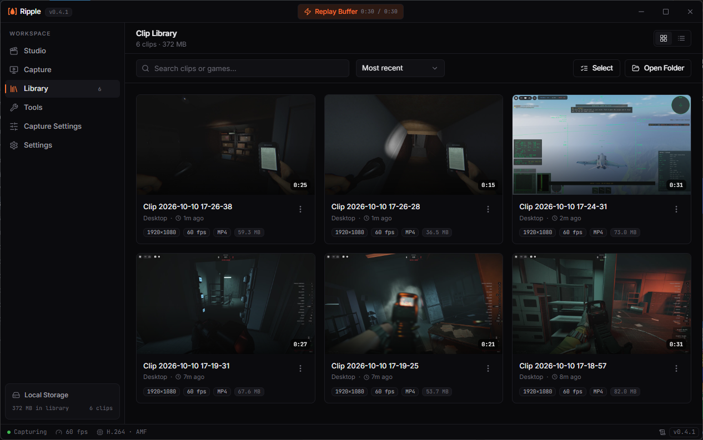
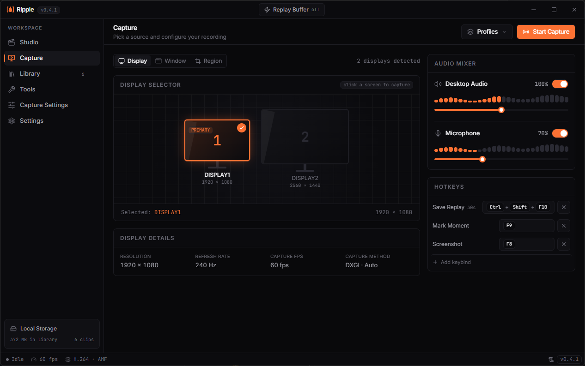

# Ripple

Ripple is a replay buffer for Windows | Win only may plan to expand. It records your screen in the background, and when something good happens you press a hotkey to save the last few seconds as a clip. Clips land in a built-in library where you can trim, compress, and share them.

Ripple is free to use. The source code is not public, and this repository only hosts the downloads, release notes, and bug reports. It may go open source I'm just testing different things etc, I'm currently working on improving rn It's just a fun project it utilizes gstreamer as the primary pipeline.

  
  

## Download

Grab the latest installer from the **[Releases](../../releases/latest)** page and run `Ripple_x.y.z_x64-setup.exe`.

- Installs for your user account only, no administrator rights needed
- Each release lists a SHA-256 checksum so you can verify the file

### About the Windows SmartScreen warning

Ripple's installer is signed for updates, but it is not yet code signed with a paid certificate. Windows may show "Windows protected your PC" the first time you run it. Click **More info**, then **Run anyway**. Unfortunately, Windows requires a costly yearly code signing certificate, which isn't feasible/easily maintainable for a solo developer project.

## What it does

- **Replay buffer.** Keeps the last stretch of gameplay or desktop in the background. Save it with a hotkey. Plenty of extras on top, like auto-starting the buffer.
- **Capture a display or a window.**
- **Hardware encoding** with NVIDIA NVENC, AMD AMF, or Intel QSV, with a software fallback (may not be default).
  - **Please note:** I don't own an NVIDIA GPU, so I have no way of testing NVENC. As a solo dev, I can only confirm 3 of the 4 encoders. Thank you for understanding!
- **Audio.** Desktop audio and microphone, with separate volume controls and an option for separate tracks. (Separate tracks are still being fixed, coming soon.)
- **Output formats.** MP4, MKV, or MOV.
- **Clip library** with thumbnails, renaming, and deleting.
- **Trimming.** A fast mode that cuts on keyframes, and a precise mode that re-encodes for frame-exact cuts.
- **Compress** a clip down to a target file size.
- **Profiles** to switch between recording setups quickly.
- **Share** a clip by uploading it to [Catbox](https://catbox.moe), which is optional. This is a bit of a stitched-on feature, so it isn't 100% reliable for embeds.
- **Runs in the tray.** Closing the window sends Ripple to the system tray instead of quitting, so your buffer keeps recording in the background. You can turn this off in Settings. It also optimizes usage while running in the background.
- **Startup options.** Launch Ripple with Windows, and optionally start the buffer as soon as it opens.
- **First-run setup** that walks you through capture, video, encoder, and storage choices so you are recording in a minute or two.
  - It will detect your encoder if you don't know which one you have. Priority is usually GPU first, then iGPU, then CPU. If you have more than one available, it will always pick the GPU. If you don't want that, select one manually. It always tells you which encoders it detected on your machine.
- **Buffer storage.** Tired of OBS forcing you onto memory? Good news, Ripple offers both memory and disk.

Default hotkeys (you can change them in Settings):

| Action | Default |
| --- | --- |
| Save clip | `Ctrl` + `Shift` + `F10` |
| Screenshot | `F8` |

## Requirements

- Windows 10 or 11, 64-bit
- A GPU with a hardware encoder is recommended, but not required, since Ripple falls back to software encoding
- WebView2 runtime, which the installer downloads for you if it is missing

## Updates

Ripple checks for updates a few seconds after it opens and lets you know when a new version is available. You decide when to install it. In Settings you can change how often it reminds you (every launch, daily, weekly, or never), turn on automatic installs, or turn the check off completely.

## Your data

| What | Where |
| --- | --- |
| Settings, clip index, thumbnails, majority app data | `%APPDATA%\com.ripplereplay.app` |
| Your clips | `Videos\Ripple` by default, or the folder you pick in Settings |

Uninstalling Ripple leaves your clips alone. The uninstaller has a checkbox to also delete the settings folder.

## Privacy

Ripple has no accounts and does not collect analytics. These are the only network connections it makes:

- **Update check:** a request to this repository on GitHub to see whether a newer version exists. You can turn it off in Settings.
- **Fonts:** the interface loads its fonts from Google Fonts.
- **Sharing:** only if you choose to share a clip, that clip is uploaded to Catbox. You need your Catbox userhash if you want to delete it later, otherwise it stays on Catbox permanently.

## Reporting a bug

Open an [issue](../../issues) and include:

- Your Ripple version (shown in Settings)
- Your Windows version and GPU
- What you were doing, and what you expected to happen

Apologies for the lack of logs; I was a little rushed, but expect them soon! As for NVIDIA users, I’d appreciate your feedback. Because I do not have an NVIDIA GPU, I cannot test it on my own at the moment—though perhaps in the future I may. This was just a project for fun, and I might go open source down the road. I really hope it works well for people, as this is one of the few projects I've taken seriously.

## License

Ripple is free to use, including for making money from content you create with it. You may not sell, re-host, patch, or rebrand the app itself. See [LICENSE](LICENSE) for the full terms.
